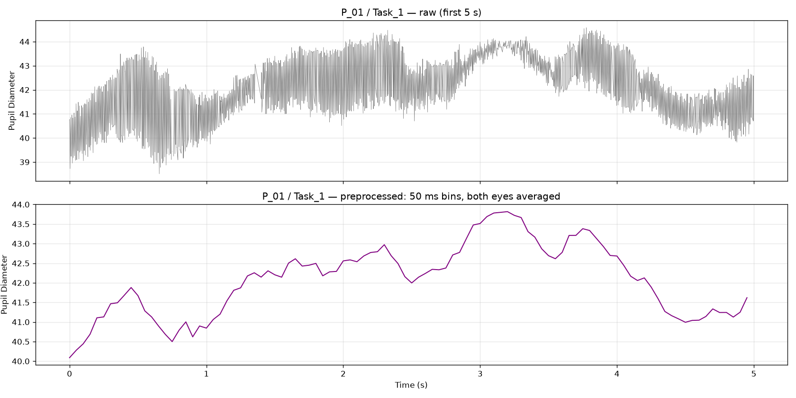

# Cognitive Load Recognition from Pupillometry

Three-class cognitive load classification (low / medium / high) from pupil diameter,
using the public COLET eye-tracking dataset.

This is a self-directed learning project. The emphasis is on careful data inspection,
leakage-free validation, and honest reporting rather than maximizing a single score.

## Data

**COLET** — COgnitive workLoad estimation based on Eye-Tracking.
47 participants, each completing 4 visual-search tasks; each (participant, task) block
is annotated with one NASA-RTLX score.

> Ktistakis, E., Skaramagkas, V., Manousos, D., Tachos, N. S., Tripoliti, E.,
> Fotiadis, D. I., & Tsiknakis, M. (2022). COLET: A dataset for cognitive workload
> estimation based on eye-tracking. *Computer Methods and Programs in Biomedicine*,
> 224, 106989. https://doi.org/10.1016/j.cmpb.2022.106989

Data available on Zenodo: https://zenodo.org/records/7766785.
The data is **not** redistributed here. Download it separately and place it at
`data/colet.parquet`.

**Key fact:** the 4.5M rows are samples, but the true number of labeled units is
**188 blocks** (47 × 4). Every model result must be read with this in mind.

## Findings during data inspection

1. **Each sample appears twice.** Rows sharing a timestamp differ by a median of
   only 0.005, i.e. near-duplicate computations of the same frame.
2. **Left and right eyes alternate.** Consecutive timestamps differ by a median of
   1.90, while timestamps two steps apart differ by only 0.25. This pattern
   (small → large → small) indicates the two eyes are sampled in turn. The
   "high-frequency jitter" visible in the raw signal is this alternation, not
   physiology.
3. **P_18 / Task_3 and Task_4 have overlapping time ranges** and internal jumps of
   up to ~6,400 s, suggesting the two recordings were merged or mislabeled.
   Both blocks are excluded.
4. **Missing data is concentrated in high-load tasks.** The 10 blocks with the most
   low-confidence samples are all Task_3 or Task_4, and every window later dropped
   for long gaps belongs to the high class.
5. **Task strongly predicts label.**

   | Task | high | low | medium |
   |---|---|---|---|
   | Task_1 | 7 | 31 | 9 |
   | Task_2 | 18 | 21 | 8 |
   | Task_3 | 39 | 3 | 4 |
   | Task_4 | 43 | 2 | 1 |



## Pipeline

| Script | Step |
|---|---|
| `src/02_preprocess.py` | Exclude P_18 Task_3/4 → mark Confidence < 0.8 as missing → average all valid samples (both eyes, duplicate rows) into 50 ms bins → linearly interpolate gaps ≤ 250 ms; longer gaps stay missing |
| `src/03_label.py` | NASA-RTLX → 0 low (< 30), 1 medium (30–49), 2 high (≥ 50) |
| `src/04_features.py` | Per-participant z-score → 10 s windows, 5 s step → features: mean, std, min, max, slope; windows containing missing data are dropped |
| `src/06_cross_validation.py` | 5-fold StratifiedGroupKFold by participant; majority-class baseline, logistic regression, random forest |

Diagnostic scripts: `02b_gap_stats.py`, `02c_timestamp_check.py`, `02d_eye_check.py`.
Superseded early versions are kept in `src/archive/`.

### Design decisions and their justification

- **Confidence threshold 0.8** — specified by the project brief. Dropped points
  have a median Confidence of 0, consistent with blink artifacts.
- **Mark as missing, don't delete.** Deleting rows removes the gap itself, so
  interpolation has nothing to fill.
- **Max interpolation gap 250 ms** — following Kret & Sjak-Shie (2019).
- **50 ms bins** — workload-related pupil changes are on the order of seconds;
  binning also merges duplicate rows and averages the two eyes onto a regular
  time grid.
- **Per-participant normalization, not per-block.** Normalizing per block would
  erase the between-task level differences that carry the signal. Only the
  participant's own pupil data is used (no labels, no other participants).
- **10 s windows.** The literature has no consensus (from ~1 s to > 90 s);
  10 s is within the commonly used range and below the shortest block (11.25 s).
- **Subject-wise splitting.** No participant ever appears in both training and
  test sets, so the evaluation measures generalization to unseen people.
- **Macro-F1 as the primary metric.** With 66% of windows in the high class,
  always predicting "high" already yields 0.66 accuracy.

## Data summary after preprocessing

- 186 blocks retained; 185 produce at least one window
  (P_24 / Task_3 is lost entirely to long gaps)
- Missing bins: 3.76% before interpolation, 0.91% after
- 1,380 windows: high 912, low 330, medium 138
- 180 windows dropped for long gaps, **all from the high class**

## Results

5-fold subject-wise cross-validation, mean ± SD across folds:

| Model | Accuracy | Macro-F1 | F1 low | F1 medium | F1 high |
|---|---|---|---|---|---|
| Baseline (always "high") | 0.66 ± 0.05 | 0.27 ± 0.01 | 0.00 | 0.00 | 0.80 ± 0.04 |
| Logistic Regression | 0.62 ± 0.05 | **0.51 ± 0.04** | 0.61 ± 0.07 | 0.18 ± 0.03 | 0.75 ± 0.04 |
| Random Forest | 0.70 ± 0.06 | **0.51 ± 0.04** | 0.58 ± 0.10 | 0.12 ± 0.10 | 0.82 ± 0.05 |

- Both models roughly **double the baseline macro-F1**, consistently across folds.
- They separate **low vs high** reasonably well but **cannot identify medium**.
- The two models are indistinguishable on macro-F1. Logistic regression predicts
  "medium" more often (at the cost of accuracy); random forest stays closer to
  "high".
- **Sensitivity check:** changing the gap threshold from 0.5 s to 0.25 s changed
  macro-F1 by < 0.01.

## Limitations

- **Task–label confound.** Task almost determines label (e.g. 43/46 Task_4 blocks
  are high). Pupil size also responds to screen luminance, so the model may partly
  learn visual differences between tasks rather than workload itself.
- **Small effective sample size.** 185 blocks, only 22 medium. Windows from the
  same block are correlated and overlap by 50%, so window-level metrics overstate
  the amount of independent evidence.
- **Single-eye bins.** No eye identifier is available, so when only one eye is
  valid within a bin, the average shifts toward that eye. Kret & Sjak-Shie (2019)
  correct for this using the local inter-eye difference; this was not possible here.
- **Normalization assumes access to a new participant's data across tasks.**
- **Pupil units** are likely camera pixels rather than millimetres.
- **Missingness is label-related**, so excluding long gaps removes high-load
  data preferentially.

## Reproducibility

```bash
python3.14 -m venv .venv
source .venv/bin/activate
python -m pip install -r requirements.txt
cd src
python 02_preprocess.py
python 03_label.py
python 04_features.py
python 06_cross_validation.py
```

Random seed fixed at 42. Python 3.14; dependency versions pinned in `requirements.txt`.

## References

- Ktistakis, E., et al. (2022). COLET: A dataset for cognitive workload estimation
  based on eye-tracking. *Computer Methods and Programs in Biomedicine*, 224, 106989.
- Kret, M. E., & Sjak-Shie, E. E. (2019). Preprocessing pupil size data: Guidelines
  and code. *Behavior Research Methods*, 51(3), 1336–1342.
  https://doi.org/10.3758/s13428-018-1075-y

## Author

Yannan (Karen) Sun — [@ksun10071991-boop](https://github.com/ksun10071991-boop)